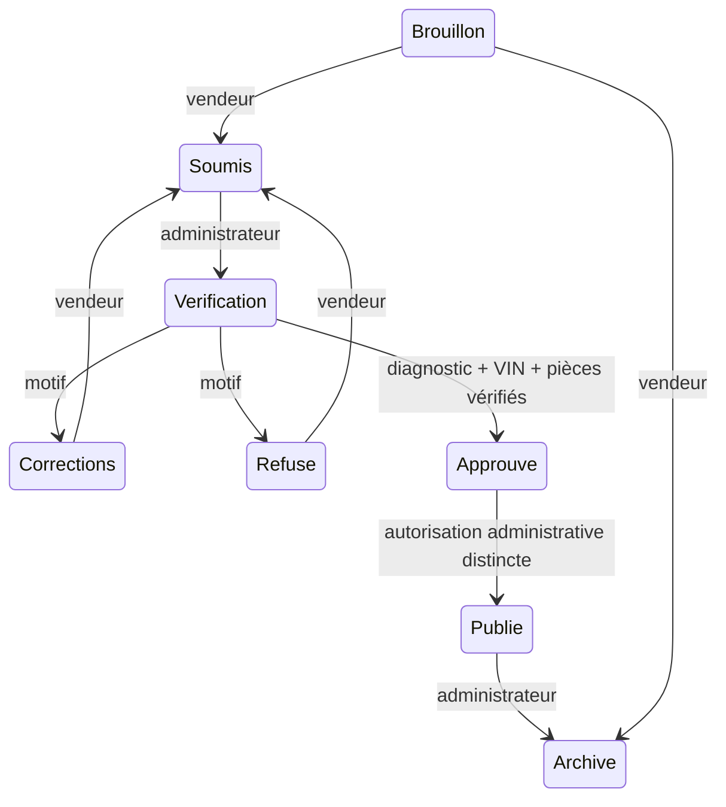

# Marketplace vendeurs — M&Y AUTO EXPORT

## Parcours et responsabilités

Le lien **Vendre mon véhicule** du catalogue ouvre `/vendre`. Un compte existant peut activer un
profil vendeur, particulier ou professionnel, sans recevoir de droits administrateur. Les comptes
professionnels indiquent leur numéro professionnel. Le formulaire comprend huit étapes :

1. Identification : marque, modèle, finition, VIN, immatriculation, première circulation, production,
   année, kilométrage, pays d'origine et de première immatriculation, lieu.
2. Technique : motorisation, énergie, puissance kW/ch, cylindrée, boîte/rapports, transmission,
   carrosserie, portes/places, Euro/CO₂ et couleurs.
3. Équipements classés et recherchables.
4. Historique, entretien, propriétaires, accidents, réparations et contrôle technique.
5. Galerie privée : avant, arrière, gauche, droite, intérieur, tableau de bord, moteur, coffre et
   dommages ; compression JPEG (2560 px, qualité 0,86), sélection multiple, glisser-déposer,
   réorganisation et photo principale. **8 vues obligatoires** au minimum, contrôlées sur le serveur.
6. Dommages : schéma SVG original, zones, type, gravité, description et photos de ce dossier.
7. Diagnostic et documents : garage agréé, référence/date/VIN/kilométrage du rapport, dix rubriques
   techniques, PDF et justificatifs privés.
8. Prix, devise EUR/TND, mode de vente, dates souhaitées, réserve TND, propositions de prix et aperçu.

Le tableau de bord propose Mes annonces, Mes brouillons, Mes diagnostics, Mes documents, État de
validation et Messages de l'administration. Les filtres Tous/Actifs/Vendu/Archivé ont des compteurs
réels. Une offre acceptée reste « Vendu » même si l'annonce est retirée. Les brouillons et les dossiers
à vérifier ou corriger sont actifs. Annuler l'identification conserve le brouillon sans le soumettre.
Les données sont verrouillées dès la soumission, sauf si l'équipe demande des corrections ou refuse.

## Validation et publication distinctes



La rubrique **Annonces vendeurs à valider** de `/admin` mène à `/admin-vendeurs`. L'administrateur
commence la vérification, lit les pièces privées, contacte le garage et confirme **trois points** :
authenticité du rapport, correspondance du VIN, validité des justificatifs. Il peut refuser ou demander
des corrections avec un message obligatoire. Le résumé public est rédigé par l'administrateur.

Une approbation n'insère rien dans le catalogue. L'action séparée **Autoriser la publication**
réévalue la complétude et l'agrément, puis modifie l'état et le catalogue dans une transaction D1.
La révision et un jeton de mutation empêchent les doubles décisions concurrentes. Le garage est
également contrôlé dans la mise à jour SQL conditionnelle, pas uniquement avant la transaction.

Une vente directe apparaît en stock. Une enchère apparaît **À venir**, jamais immédiatement active.
L'ouverture et la date définitive sont gérées dans l'administration du catalogue existante ; les dates
saisies par le vendeur sont des dates souhaitées. Les fiches HTML côté serveur présentent également le badge, les photos, les équipements et les dommages ; la publication déclenche le contrôle SEO existant. Le cron de purge est distinct des deux crons SEO.

Les règles existantes (caution, pas minimal,
prolongation, réserve, classement, acceptation) restent inchangées. Pour une vente directe avec
propositions autorisées, un acheteur connecté ayant accepté les CGV peut proposer un prix : l'offre
rejoint la file administrative existante. Un vendeur ne peut pas proposer un prix sur son véhicule.

Les caractéristiques publiées reprennent aussi les champs des filtres du catalogue (boîte, couleur, puissance, cylindrée, portes, sièges et état déclaré).

Le catalogue affiche les caractéristiques, équipements, dommages et leurs photos, le nom du garage,
la date et le résumé autorisé du diagnostic. Les textes destinés au public sont aussi vérifiés contre le VIN et la plaque connus avant publication. Le VIN, la plaque, la référence du rapport, les coordonnées
et les justificatifs ne sont pas ajoutés à l'objet public. Le badge est calculé depuis l'état publié
validé et le contenu technique approuvé ; un champ injecté dans le brouillon ou le fichier statique
ne suffit pas. Les modifications techniques/photos via l’éditeur générique sont refusées et nécessitent un nouveau dossier validé ; prix/calendrier restent modifiables et conservent le badge. Une écriture manuelle hors circuit qui change les caractéristiques annule le badge.
Le diagnostic n'est pas une garantie d'absence de défaut ni un remplacement du contrôle technique légal.

## Diagnostic et exigences documentaires

Un agrément actif exige un numéro professionnel et une date de validité non expirée. Les anciens
garages sans ces champs ne sont pas proposés aux vendeurs tant qu'ils ne sont pas complétés.
Le rapport indique référence, date non future, VIN et kilométrage, avec observations moteur, boîte,
freinage, suspension, direction, électronique, batterie, carrosserie, pneumatiques et défauts.

**Aucune extraction OCR ni authentification automatique du PDF n'est revendiquée.** Le serveur
compare le VIN déclaré du rapport à celui du véhicule ; l'administrateur vérifie cette déclaration
dans le rapport et auprès du garage. Un rapport illisible doit être clarifié avec le garage ou corrigé.
La structure `seller_diagnostics` permettra d'ajouter ultérieurement un espace garage et une signature.

Pièces de base : immatriculation, propriété/droit de vente et diagnostic PDF. Contrôle technique si
déclaré applicable, facture de vente pour un professionnel. Les autres pièces sont facultatives,
sauf règle de plateforme complémentaire. `/admin-vendeurs` permet de définir ces exigences par pays
et type de vendeur (`*` pour tous). Le pays est celui de première immatriculation, à défaut d'origine.
La matrice est une configuration métier à renseigner après examen des exigences du pays : elle ne
prétend pas remplacer une analyse juridique et aucune règle nationale n'est inventée par le code.

## Données et migrations

- **0014_dossiers_vendeurs.sql** : profils, garages, dossiers et fichiers.
- **0015_marketplace_vendeurs.sql** : type/numéro professionnel, validité des garages, `stage`, jetons
  de mutation et purge, métadonnées de photos, diagnostics, dommages, événements de validation,
  revendications uniques du VIN, tentatives d'envoi, accès temporaires, file de suppression.
- **0016_regles_documents_vendeurs.sql** : exigences complémentaires par pays/type de vendeur.

0012 conserve le statut historique pour compatibilité et introduit `stage` comme source de vérité.
Les anciens `pending` deviennent `submitted`, les anciens `approved` déjà publiés deviennent `published`.
Les données 0011 et les fichiers R2 sont conservés. Les anciens brouillons doivent être complétés.
Les VIN déjà dupliqués sont attribués au dossier le plus ancien ; les autres doivent être régularisés.
Aucune migration descendante destructrice automatique n'est fournie.

Le JSON du dossier contient caractéristiques, équipements et historique. Les diagnostics et dommages
ont aussi des tables dédiées. Les changements d'état alimentent `seller_validation_events` via un
trigger transactionnel (acteur, date, état source/cible, motif). Les fichiers ont des identifiants
aléatoires ; les noms d'origine ne sont pas enregistrés. Le profil vendeur complète `users` sans
ajouter un rôle pouvant être confondu avec `admin`.

## Routes API

Toutes les écritures exigent l'origine du site et une session. Les préfixes sont `/api/seller/` pour
le propriétaire et `/api/admin/seller/` pour l'administration. Les dossiers d'autrui sont invisibles.

| Méthode | Chemin après préfixe | Droits / fonction |
|---|---|---|
| GET, PUT | `profile` | Vendeur : coordonnées, type, numéro professionnel |
| GET | `garages` | Garages valides côté vendeur, tous côté admin |
| POST | `garages` | Admin : créer un agrément complet |
| PUT | `garages/:id` | Admin : état, validité, numéro professionnel |
| GET, POST | `document-rules` | Lecture connectée ; modification admin |
| GET | `submissions` | Dossiers propres ; tous pour l'admin |
| POST | `submissions` | Vendeur : nouveau brouillon |
| GET | `submissions/:id` | Détail, pièces, audit, éléments manquants |
| PUT | `submissions/:id` | Vendeur : enregistrer un dossier modifiable |
| POST | `submissions/:id/files?kind=...` | Vendeur : envoyer une pièce binaire |
| PUT | `submissions/:id/photos` | Vendeur : ordre complet et photo principale |
| POST | `submissions/:id/submit` | Vendeur : soumettre un dossier complet |
| POST | `submissions/:id/review` | Admin : commencer, corriger, refuser, approuver |
| POST | `submissions/:id/publish` | Admin : publication distincte après approbation |
| POST | `submissions/:id/archive` | Vendeur : brouillon/refus/corrections ; admin : annonce publiée |
| GET, DELETE | `files/:id` | Lire avec session ; supprimer dans un brouillon propriétaire |
| POST | `files/:id/access` | Lien temporaire de 5 minutes, lié à l'utilisateur |
| GET | `file-access/:token` | Session et jeton valide, propriétaire/admin |
| POST | `offers` | Acheteur : proposition TND sur une vente directe publiée éligible |
| POST | `cleanup` | Admin : appliquer conservation et traiter la file de suppression |

`GET /seller-media/:id` ne sert que les images d'un dossier publié dont le véhicule n'est pas retiré.
Les PDF et les justificatifs ne passent jamais par cette route.

Les mutations d'un dossier transmettent `revision`. Une version périmée reçoit 409 sans modifier
le dossier. L'envoi de fichier transmet son type MIME et ses octets bruts ; il ne fait pas de multipart.
Les photo-identifiants de dommages et les ordres de galerie sont vérifiés contre les fichiers du dossier.

## Sécurité et conservation

- Session HttpOnly existante, CSRF par origine, contrôle de rôle et de propriétaire à chaque accès.
- Bucket **SELLER_DOCUMENTS privé**, distinct de PHOTOS et DOCUMENTS. Ni domaine public ni `r2.dev`.
- Accès temporaires liés à l'utilisateur et à la session active ; jetons hachés, expiration 5 minutes.
- Documents téléchargés en pièces jointes, `no-store`, `nosniff`, CSP restrictive. Seules les images
  privées peuvent être prévisualisées dans l'application après authentification.
- JSON limité à 256 Ko ; fichiers à 10 Mo et 40 pièces par dossier ; 20 tentatives d'envoi par minute
  par compte, contrôlées dans D1. Formats JPEG/PNG/WebP/PDF, signature de fichier vérifiée ; SVG/HTML refusés.
- Les PDF avec actions JavaScript/lancement, fichiers intégrés, XFA, RichMedia ou chiffrement détectés
  sont refusés. **Ce filtre n'est pas un antivirus complet ni un parseur PDF garantissant l'innocuité**.
  Pour une exploitation à grande échelle, intégrer un scanner dédié et sa quarantaine avant lecture.
- Le VIN fait l'objet d'une revendication unique transactionnelle ; un archivage libère la revendication.
- Conservation par défaut **180 jours d'inactivité** pour les brouillons, refus et archives ; minimum
  configurable 30 jours. Les dossiers soumis/en vérification/approuvés/publiés ne sont pas purgés.
- Le cron prévu à **02:30 UTC** purge les données privées éligibles, leurs métadonnées et les fichiers
  via une file de suppression R2 réessayable. Une exécution traite au plus 20 dossiers et 50 clés R2 ;
  le nettoyage admin permet de vider un reliquat. Les motifs d'audit sont expurgés à la purge ; les
  états historiques sont conservés sans les données privées du dossier. Le profil de compte suit
  le cycle de vie du compte, distinct des pièces de véhicule.

La création d'un agrément, l'authenticité d'un rapport et le contenu destiné au public relèvent d'un
examen réel par l'équipe. Le logiciel n'interroge pas de registre professionnel externe et ne signe
pas le rapport à la place du garage.

## Exécution et validation locales

Prérequis : Node compatible Wrangler, Python, Playwright et Chromium. Depuis le projet :

```
npm ci
WRANGLER=/chemin/vers/wrangler python3 -m unittest discover -s tests -v
```

Les tests utilisent exclusivement D1/R2 locaux dans des dossiers temporaires. Ils couvrent la création,
les brouillons, les pièces, les huit photos, le diagnostic/VIN, les agréments, les doublons, les accès,
l'expiration, les envois excessifs, les PDF actifs, la validation, la publication séparée, la devise,
les propositions, la purge, les règles par pays et le parcours complet Chromium. La suite existante
couvre aussi catalogue, administration, OAuth/MCP, CGV, enchères, concurrence et caution.

Prévisualisation de cette session : `http://127.0.0.1:8787/vendre`, configuration et données isolées
sous `.wrangler/vendeur-preview/`. Les comptes et garages sont à renseigner dans cette base neuve.
Le catalogue JSON existant reste visible ; aucun dossier vendeur réel n'a été publié par le développement.

## Mise en service, uniquement après autorisation explicite

Les commandes suivantes sont des instructions, **elles n'ont pas été exécutées sur la production** :

```
npx wrangler r2 bucket create my-auto-export-seller-private
npx wrangler r2 bucket create my-auto-export-seller-private-preview
npx wrangler d1 migrations apply DB --remote
npx wrangler deploy
```

Avant cette étape : relire la PR, sauvegarder la base et vérifier l'ordre des migrations avec les autres
branches. Appliquer le schéma avant le Worker qui en dépend. Le bucket privé ne doit pas être exposé
sur un domaine public. `wrangler.jsonc` prépare son binding, `SELLER_RETENTION_DAYS=180` et le cron.
Renseigner les garages réels, leurs numéros et dates, puis les exigences documentaires de plateforme.
La première publication exige toujours deux actions administratives, et jamais une soumission seule.

Cette branche repose sur `config/agents-ia` (base d’intégration finale `344b7e9`), qui porte les filtres, la sécurité, le SEO, l'authentification et les enchères/cautions
nécessaires. La PR est empilée sur cette branche pour ne pas annuler ses changements. Elle pourra être
reciblée vers main après l'intégration de cette base, sans fusion automatique par Codex.
